# Здания: активный состав

> Файл СОБИРАЕТСЯ САМ (`Tools/docs/buildings_reference.py`, после каждого `setup` в `run.ps1`): не правь его руками.
> Состав и числа — лист «Здания» (`buildings.csv`), еда — `economy.csv`, скрытые — `BuildingIds.Hidden`,
> иконки — `UI/Icons`, описания — `Design/buildings/descriptions.tsv` (новое здание: добавь туда строку).
> Цены и время стройки — песочницы (лист «Песочница: здания», `sandbox.csv`; ур.1 = постройка, дальше — улучшение);
> остальные числа — базовые; Нашествие переопределяет своё своим листом.

Активных зданий: **53** (скрыто: 5).

⚠ Нет иконки: Shipyard ур.2, Shipyard ур.3, Shipyard ур.4, Shipyard ур.5, Lighthouse ур.2, Lighthouse ур.3, Lighthouse ур.4, Lighthouse ур.5, TaxHouse ур.2, TaxHouse ур.3, TaxHouse ур.4, TaxHouse ур.5.

**Разделы:** [Город](#город) · [Склады](#склады) · [Производство](#производство) · [Еда](#еда) · [Оборона](#оборона) · [Водные](#водные) · [Развлечения и украшения](#развлечения-и-украшения)

## Город

### Лачуга `Hovel`

Первое жильё: сама рождает жителей до своей вместимости (в голодном городе рождение стоит).

| | ур. 1 | ур. 2 | ур. 3 | ур. 4 | ур. 5 |
|---|---|---|---|---|---|
| | 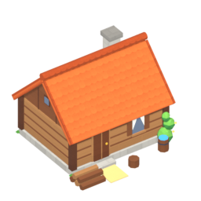 | 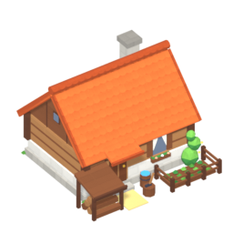 | 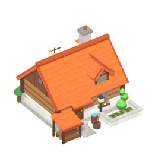 | 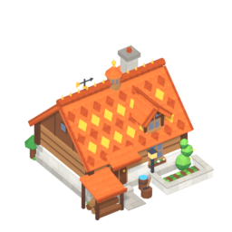 | 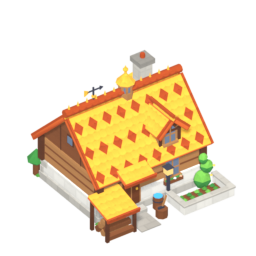 |
| Прочность | 80 | 128 | 200 | 288 | 400 |
| Жильё | 5 | 8 | 10 | 12 | 14 |
| Цена (песочница) | дерево 7 | дерево 16 | дерево 28 | дерево 49 | дерево 86 |
| Стройка, с (песочница) | 6 | 8 | 10 | 13 | 19 |

### Коттедж `Cottage`

Жильё побольше; ставится, когда в городе уже есть Лачуга.

| | ур. 1 | ур. 2 | ур. 3 | ур. 4 | ур. 5 |
|---|---|---|---|---|---|
| | 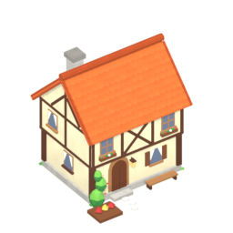 | 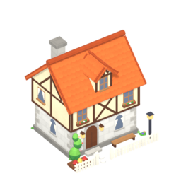 | 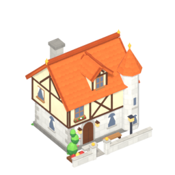 | 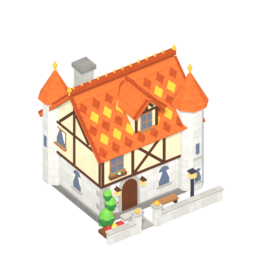 | 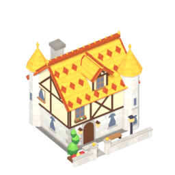 |
| Прочность | 120 | 192 | 300 | 432 | 600 |
| Жильё | 8 | 12 | 16 | 20 | 24 |
| Цена (песочница) | дерево 25, камень 8 | дерево 40, камень 13 | дерево 70, камень 22 | дерево 122, камень 38 | дерево 214, камень 67 |
| Стройка, с (песочница) | 12 | 14 | 20 | 30 | 48 |

### Особняк `Manor`

Самое большое жильё; требует Коттедж.

| | ур. 1 | ур. 2 | ур. 3 | ур. 4 | ур. 5 |
|---|---|---|---|---|---|
| | 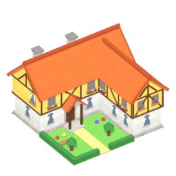 | 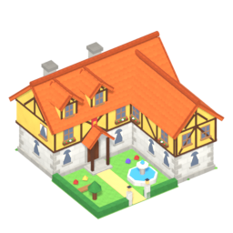 | 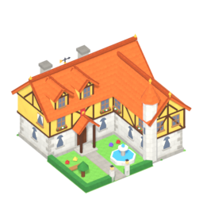 | 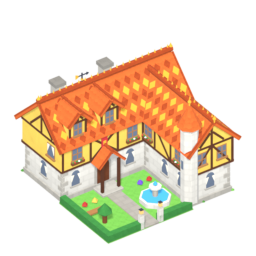 | 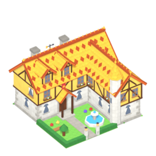 |
| Прочность | 200 | 320 | 500 | 720 | 1000 |
| Жильё | 14 | 20 | 28 | 36 | 44 |
| Цена (песочница) | дерево 55, камень 25 | дерево 88, камень 40 | дерево 154, камень 70 | дерево 270, камень 122 | дерево 472, камень 214 |
| Стройка, с (песочница) | 24 | 25 | 40 | 65 | 109 |

### Ратуша `Castle`

Ратуша, сердце города: стоит с начала игры бесплатно; если её разрушат — поражение.

| | ур. 1 | ур. 2 | ур. 3 | ур. 4 | ур. 5 |
|---|---|---|---|---|---|
| | 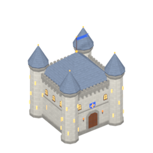 | 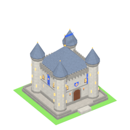 | 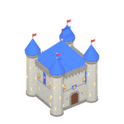 | 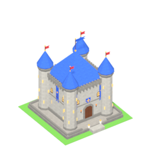 | 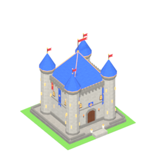 |
| Прочность | 400 | 640 | 1000 | 1440 | 2000 |
| Защита | 20 | 32 | 50 | 72 | 100 |
| Жильё | 7 | 7 | 7 | 7 | 7 |
| Цена (песочница) | — | дерево 100, камень 60 | дерево 220, камень 150, уголь 20, золото 40 | дерево 385, камень 262, уголь 35, золото 70 | дерево 674, камень 459, уголь 61, золото 122 |
| Стройка, с (песочница) | 0 | 30 | 70 | 119 | 203 |

### Дорога `Road`

Дорога для жителей; на дорогах ставятся Ворота.

| | ур. 1 | ур. 2 | ур. 3 | ур. 4 | ур. 5 |
|---|---|---|---|---|---|
| |  | 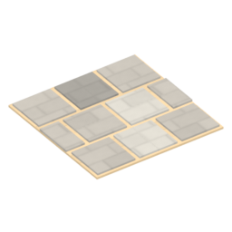 | 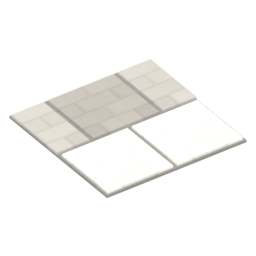 | 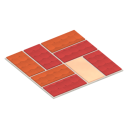 |  |
| Прочность | 40 | 64 | 100 | 144 | 200 |
| Цена (песочница) | камень 1 | камень 5 | камень 8 | камень 14 | камень 24 |
| Стройка, с (песочница) | 1 | 7 | 7 | 8 | 10 |

### Лаборатория `Laboratory`

Исследования: открывает здания, их уровни и юнитов; учёные — по одному месту на исследование.

| | ур. 1 | ур. 2 | ур. 3 | ур. 4 | ур. 5 |
|---|---|---|---|---|---|
| | 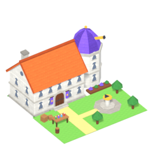 | 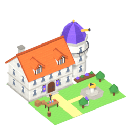 |  | 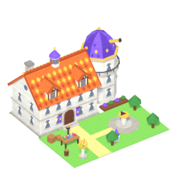 | 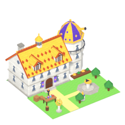 |
| Прочность | 160 | 256 | 400 | 576 | 800 |
| Рабочие | 10 | 10 | 10 | 10 | 10 |
| Цена (песочница) | дерево 40, камень 30 | дерево 64, камень 48, железо 16 | дерево 112, камень 84, железо 28 | дерево 196, камень 147, железо 49 | дерево 343, камень 257, железо 86 |
| Стройка, с (песочница) | 22 | 25 | 40 | 65 | 109 |

### Лечебница `HealerHouse`

Лечебница: лечит заболевших жителей в своём радиусе.

| | ур. 1 | ур. 2 | ур. 3 | ур. 4 | ур. 5 |
|---|---|---|---|---|---|
| | 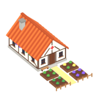 | 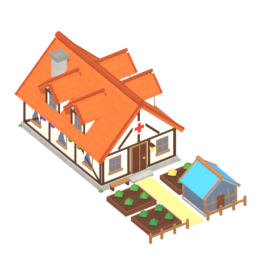 | 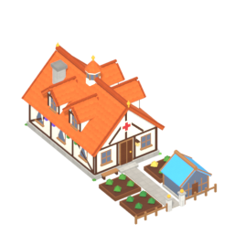 | 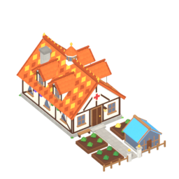 | 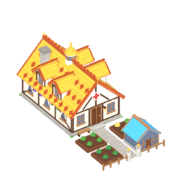 |
| Прочность | 130 | 208 | 325 | 468 | 650 |
| Рабочие | 2 | 3 | 4 | 5 | 6 |
| Радиус | 16 | 20 | 26 | 31 | 37 |
| Цена (песочница) | дерево 30, камень 15 | дерево 48, камень 24 | дерево 84, камень 42 | дерево 147, камень 74 | дерево 257, камень 129 |
| Стройка, с (песочница) | 15 | 17 | 25 | 39 | 64 |

### Пожарная бригада `FireBrigade`

Пожарная бригада: тушит пожары в своём радиусе, чем больше пожарных — тем быстрее.

| | ур. 1 | ур. 2 | ур. 3 | ур. 4 | ур. 5 |
|---|---|---|---|---|---|
| | 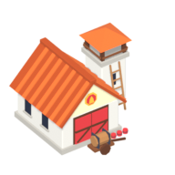 | 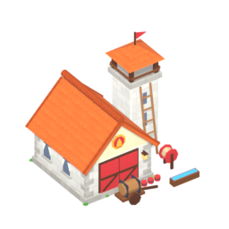 | 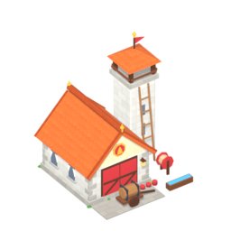 | 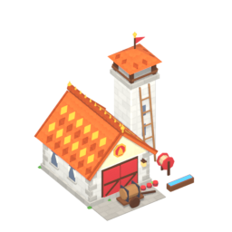 | 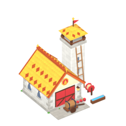 |
| Прочность | 130 | 208 | 325 | 468 | 650 |
| Рабочие | 2 | 3 | 4 | 5 | 6 |
| Радиус | 18 | 24 | 30 | 36 | 43 |
| Цена (песочница) | дерево 30, камень 15 | дерево 48, камень 24 | дерево 84, камень 42 | дерево 147, камень 74 | дерево 257, камень 129 |
| Стройка, с (песочница) | 15 | 17 | 25 | 39 | 64 |

### Колодец `Well`

Колодец: жители в его радиусе реже болеют.

| | ур. 1 | ур. 2 | ур. 3 | ур. 4 | ур. 5 |
|---|---|---|---|---|---|
| | 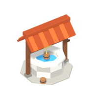 | 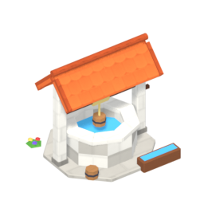 |  | 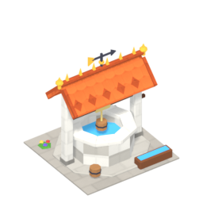 | 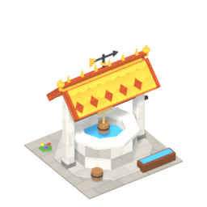 |
| Прочность | 60 | 96 | 150 | 216 | 300 |
| Радиус | 14 | 18 | 24 | 29 | 35 |
| Цена (песочница) | дерево 5, камень 2 | дерево 8, камень 16 | дерево 14, камень 28 | дерево 24, камень 49 | дерево 43, камень 86 |
| Стройка, с (песочница) | 6 | 10 | 12 | 17 | 25 |

### Налоговый дом `TaxHouse`

Налоговый дом: каждый уровень +0,2 монеты с жителя в день; один на город; открывается и улучшается в Лаборатории за кристаллы.

| | ур. 1 | ур. 2 | ур. 3 | ур. 4 | ур. 5 |
|---|---|---|---|---|---|
| | 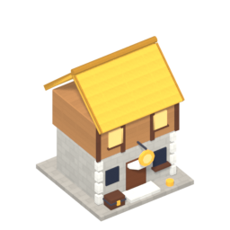 | — | — | — | — |
| Прочность | 160 | 256 | 400 | 576 | 800 |
| Цена (песочница) | дерево 150, камень 200 | — | — | — | — |
| Стройка, с (песочница) | 20 | 15 | 20 | 25 | 30 |

### Зал дипломатии `DiplomacyHall`

Зал дипломатии: открывает отношения с соседним королевством (мир, торговля, война); один на город; уровни — выгоднее сделки и меньше контрибуция.

| | ур. 1 | ур. 2 | ур. 3 | ур. 4 | ур. 5 |
|---|---|---|---|---|---|
| | 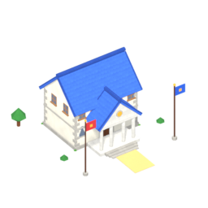 | 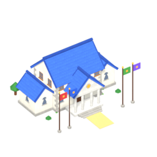 | 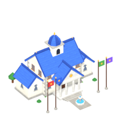 | 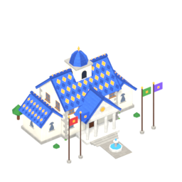 | 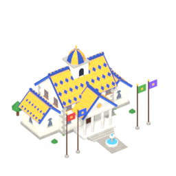 |
| Прочность | 200 | 320 | 500 | 720 | 1000 |
| Цена (песочница) | дерево 40, камень 30 | дерево 64, камень 48, железо 16 | дерево 112, камень 84, железо 28 | дерево 196, камень 147, железо 49 | дерево 343, камень 257, железо 86 |
| Стройка, с (песочница) | 22 | 25 | 40 | 65 | 109 |

## Склады

### Склад `Warehouse`

Склад: хранит дерево, камень, железо и уголь; с уровнем вмещает больше.

| | ур. 1 | ур. 2 | ур. 3 | ур. 4 | ур. 5 |
|---|---|---|---|---|---|
| | 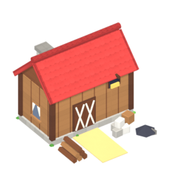 |  |  |  |  |
| Прочность | 120 | 192 | 300 | 432 | 600 |
| Склад | 300 | 600 | 1000 | 1450 | 2000 |
| Цена (песочница) | дерево 18, камень 5 | дерево 48, камень 16 | дерево 84, камень 28 | дерево 147, камень 49 | дерево 257, камень 86 |
| Стройка, с (песочница) | 10 | 16 | 23 | 35 | 57 |

### Сокровищница `Treasury`

Сокровищница: хранит золото и монеты.

| | ур. 1 | ур. 2 | ур. 3 | ур. 4 | ур. 5 |
|---|---|---|---|---|---|
| |  |  |  |  |  |
| Прочность | 200 | 320 | 500 | 720 | 1000 |
| Склад | 500 | 1000 | 1800 | 2600 | 3600 |
| Цена (песочница) | дерево 10, камень 40 | дерево 16, камень 64 | дерево 28, камень 112 | дерево 49, камень 196 | дерево 86, камень 343 |
| Стройка, с (песочница) | 16 | 18 | 27 | 43 | 70 |

### Большой склад `BigWarehouse`

Большой склад: второй ярус склада, требует обычный Склад.

| | ур. 1 | ур. 2 | ур. 3 | ур. 4 | ур. 5 |
|---|---|---|---|---|---|
| |  |  |  |  |  |
| Прочность | 260 | 416 | 650 | 936 | 1300 |
| Склад | 800 | 1600 | 2600 | 3750 | 5200 |
| Цена (песочница) | дерево 80, камень 40 | дерево 128, камень 64 | дерево 224, камень 112 | дерево 392, камень 196 | дерево 686, камень 343 |
| Стройка, с (песочница) | 34 | 35 | 56 | 94 | 160 |

### Большая сокровищница `BigTreasury`

Большая сокровищница: второй ярус, требует Сокровищницу.

| | ур. 1 | ур. 2 | ур. 3 | ур. 4 | ур. 5 |
|---|---|---|---|---|---|
| |  |  |  |  |  |
| Прочность | 420 | 672 | 1050 | 1512 | 2100 |
| Склад | 1300 | 2600 | 4600 | 6600 | 9150 |
| Цена (песочница) | дерево 30, камень 110 | дерево 48, камень 176 | дерево 84, камень 308 | дерево 147, камень 539 | дерево 257, камень 943 |
| Стройка, с (песочница) | 39 | 40 | 65 | 109 | 186 |

### Кладовая `Granary`

Кладовая: хранит еду всего города.

| | ур. 1 | ур. 2 | ур. 3 | ур. 4 | ур. 5 |
|---|---|---|---|---|---|
| |  |  |  |  |  |
| Прочность | 110 | 176 | 275 | 396 | 550 |
| Склад | 200 | 400 | 700 | 1000 | 1400 |
| Цена (песочница) | дерево 15, камень 3 | дерево 40, камень 8 | дерево 70, камень 14 | дерево 122, камень 24 | дерево 214, камень 43 |
| Стройка, с (песочница) | 8 | 13 | 19 | 28 | 45 |

### Большая кладовая `BigGranary`

Большая кладовая: второй ярус, требует Кладовую.

| | ур. 1 | ур. 2 | ур. 3 | ур. 4 | ур. 5 |
|---|---|---|---|---|---|
| |  |  |  |  |  |
| Прочность | 230 | 368 | 575 | 828 | 1150 |
| Склад | 550 | 1100 | 1900 | 2750 | 3800 |
| Цена (песочница) | дерево 70, камень 30 | дерево 112, камень 48 | дерево 196, камень 84 | дерево 343, камень 147 | дерево 600, камень 257 |
| Стройка, с (песочница) | 29 | 30 | 48 | 80 | 135 |

## Производство

### Лесопилка `Sawmill`

Лесопилка: лесоруб рубит деревья вокруг и даёт дерево.

| | ур. 1 | ур. 2 | ур. 3 | ур. 4 | ур. 5 |
|---|---|---|---|---|---|
| |  |  |  |  |  |
| Прочность | 100 | 160 | 250 | 360 | 500 |
| Рабочие | 1 | 2 | 3 | 4 | 5 |
| Радиус сбора | 12 | 17 | 24 | 29 | 35 |
| Цена (песочница) | дерево 12 | дерево 32, камень 8 | дерево 56, камень 14 | дерево 98, камень 24 | дерево 172, камень 43 |
| Стройка, с (песочница) | 7 | 12 | 16 | 24 | 38 |

### Каменоломня `Quarry`

Каменоломня: каменотёс бьёт камни вокруг и даёт камень.

| | ур. 1 | ур. 2 | ур. 3 | ур. 4 | ур. 5 |
|---|---|---|---|---|---|
| |  |  |  |  |  |
| Прочность | 110 | 176 | 275 | 396 | 550 |
| Рабочие | 1 | 2 | 3 | 4 | 5 |
| Радиус сбора | 20 | 28 | 38 | 46 | 55 |
| Цена (песочница) | дерево 8, камень 12 | дерево 32 | дерево 56 | дерево 98 | дерево 172 |
| Стройка, с (песочница) | 7 | 11 | 14 | 21 | 32 |

### Железный рудник `IronMine`

Железный рудник: ставится только на жилу, даёт железную руду.

| | ур. 1 | ур. 2 | ур. 3 | ур. 4 | ур. 5 |
|---|---|---|---|---|---|
| |  |  |  |  |  |
| Прочность | 110 | 176 | 275 | 396 | 550 |
| Рабочие | 3 | 4 | 5 | 6 | 7 |
| Цена (песочница) | дерево 25, камень 15 | дерево 40, камень 24, уголь 10 | дерево 70, камень 42, уголь 22 | дерево 122, камень 74, уголь 38 | дерево 214, камень 129, уголь 67 |
| Стройка, с (песочница) | 14 | 17 | 26 | 41 | 68 |

### Угольный рудник `CoalMine`

Угольный рудник: ставится только на жилу, даёт уголь.

| | ур. 1 | ур. 2 | ур. 3 | ур. 4 | ур. 5 |
|---|---|---|---|---|---|
| |  |  |  |  |  |
| Прочность | 100 | 160 | 250 | 360 | 500 |
| Рабочие | 3 | 4 | 5 | 6 | 7 |
| Цена (песочница) | дерево 25, камень 10 | дерево 40, камень 16, железо 6 | дерево 70, камень 28, железо 14 | дерево 122, камень 49, железо 24 | дерево 214, камень 86, железо 43 |
| Стройка, с (песочница) | 13 | 15 | 23 | 35 | 57 |

### Плавильня `Smelter`

Плавильня: из руды и угля плавит слитки, из золота и угля чеканит монеты; что делать — выбирает игрок в карточке.

| | ур. 1 | ур. 2 | ур. 3 | ур. 4 | ур. 5 |
|---|---|---|---|---|---|
| |  |  |  |  |  |
| Прочность | 150 | 240 | 375 | 540 | 750 |
| Рабочие | 2 | 3 | 4 | 5 | 6 |
| Цена (песочница) | дерево 35, камень 25 | дерево 56, камень 40 | дерево 98, камень 70 | дерево 172, камень 122 | дерево 300, камень 214 |
| Стройка, с (песочница) | 19 | 20 | 31 | 50 | 83 |

### Медный рудник `CopperMine`

Медный рудник: ставится только на жилу, даёт медную руду.

| | ур. 1 | ур. 2 | ур. 3 | ур. 4 | ур. 5 |
|---|---|---|---|---|---|
| |  |  |  |  |  |
| Прочность | 110 | 176 | 275 | 396 | 550 |
| Рабочие | 3 | 4 | 5 | 6 | 7 |
| Цена (песочница) | дерево 25, камень 15 | дерево 40, камень 24 | дерево 70, камень 42 | дерево 122, камень 74 | дерево 214, камень 129 |
| Стройка, с (песочница) | 14 | 16 | 23 | 35 | 57 |

### Золотой рудник `GoldMine`

Золотой рудник: ставится только на жилу, даёт золотую руду (в Плавильне из неё чеканят монеты).

| | ур. 1 | ур. 2 | ур. 3 | ур. 4 | ур. 5 |
|---|---|---|---|---|---|
| |  |  |  |  |  |
| Прочность | 120 | 192 | 300 | 432 | 600 |
| Рабочие | 3 | 4 | 5 | 6 | 7 |
| Цена (песочница) | дерево 30, камень 20 | дерево 48, камень 32 | дерево 84, камень 56 | дерево 147, камень 98 | дерево 257, камень 172 |
| Стройка, с (песочница) | 16 | 18 | 27 | 43 | 70 |

## Еда

### Рыбацкая хижина `FisherHut`

Рыбацкая хижина: ставится у воды, даёт еду каждый день; косяк рыбы в радиусе удваивает улов.

| | ур. 1 | ур. 2 | ур. 3 | ур. 4 | ур. 5 |
|---|---|---|---|---|---|
| |  |  |  |  |  |
| Прочность | 90 | 144 | 225 | 324 | 450 |
| Рабочие | 1 | 1 | 1 | 1 | 1 |
| Еда в день | 3 | 4 | 5 | 6 | 7 |
| Цена (песочница) | дерево 10 | дерево 24 | дерево 42 | дерево 74 | дерево 129 |
| Стройка, с (песочница) | 6 | 10 | 12 | 17 | 25 |

### Ферма `Farm`

Ферма: даёт еду каждый день; на плодородной земле больше; открыта с начала.

| | ур. 1 | ур. 2 | ур. 3 | ур. 4 | ур. 5 |
|---|---|---|---|---|---|
| |  |  |  |  |  |
| Прочность | 70 | 112 | 175 | 252 | 350 |
| Рабочие | 1 | 1 | 1 | 1 | 1 |
| Еда в день | 3 | 4 | 5 | 6 | 7 |
| Цена (песочница) | дерево 10, камень 2 | дерево 24, камень 8 | дерево 42, камень 14 | дерево 74, камень 24 | дерево 129, камень 43 |
| Стройка, с (песочница) | 7 | 11 | 14 | 21 | 32 |

### Пекарня `Baker`

Пекарня: каждая работающая Ферма в её радиусе даёт больше еды (+уровень пекарни); бонусы пекарен складываются; требует Ферму.

| | ур. 1 | ур. 2 | ур. 3 | ур. 4 | ур. 5 |
|---|---|---|---|---|---|
| |  |  |  |  |  |
| Прочность | 110 | 176 | 275 | 396 | 550 |
| Рабочие | 1 | 1 | 1 | 1 | 1 |
| Радиус | 6 | 6 | 6 | 6 | 6 |
| Бонус еды соседям | 1 | 2 | 3 | 4 | 5 |
| Цена (песочница) | дерево 30, камень 10 | дерево 48, камень 16 | дерево 84, камень 28 | дерево 147, камень 49 | дерево 257, камень 86 |
| Стройка, с (песочница) | 14 | 16 | 23 | 35 | 57 |

### Коптильня `Smokehouse`

Коптильня: то же для Рыбацких хижин и Свиноферм в радиусе; требует Рыбацкую хижину.

| | ур. 1 | ур. 2 | ур. 3 | ур. 4 | ур. 5 |
|---|---|---|---|---|---|
| |  |  |  |  |  |
| Прочность | 110 | 176 | 275 | 396 | 550 |
| Рабочие | 1 | 1 | 1 | 1 | 1 |
| Радиус | 6 | 6 | 6 | 6 | 6 |
| Бонус еды соседям | 1 | 2 | 3 | 4 | 5 |
| Цена (песочница) | дерево 25, камень 8 | дерево 40, камень 13 | дерево 70, камень 22 | дерево 122, камень 38 | дерево 214, камень 67 |
| Стройка, с (песочница) | 12 | 14 | 20 | 30 | 48 |

### Свиноферма `PigFarm`

Свиноферма: даёт много еды каждый день; открывается в Лаборатории; не у самой воды.

| | ур. 1 | ур. 2 | ур. 3 | ур. 4 | ур. 5 |
|---|---|---|---|---|---|
| |  |  |  |  |  |
| Прочность | 120 | 192 | 300 | 432 | 600 |
| Рабочие | 1 | 1 | 1 | 1 | 1 |
| Еда в день | 5 | 10 | 15 | 20 | 25 |
| Цена (песочница) | дерево 45, камень 15 | дерево 72, камень 24 | дерево 126, камень 42 | дерево 220, камень 74 | дерево 386, камень 129 |
| Стройка, с (песочница) | 13 | 14 | 21 | 32 | 51 |

### Фруктовый сад `Orchard`

Фруктовый сад: даёт много еды каждый день; открывается в Лаборатории; не у самой воды.

| | ур. 1 | ур. 2 | ур. 3 | ур. 4 | ур. 5 |
|---|---|---|---|---|---|
| |  |  |  |  |  |
| Прочность | 80 | 128 | 200 | 288 | 400 |
| Рабочие | 1 | 1 | 1 | 1 | 1 |
| Еда в день | 5 | 10 | 15 | 20 | 25 |
| Цена (песочница) | дерево 40, камень 12 | дерево 64, камень 19 | дерево 112, камень 34 | дерево 196, камень 59 | дерево 343, камень 103 |
| Стройка, с (песочница) | 7 | 11 | 14 | 21 | 32 |

## Оборона

### Башня `Tower`

Башня: стреляет по оркам; требует Забор.

| | ур. 1 | ур. 2 | ур. 3 | ур. 4 | ур. 5 |
|---|---|---|---|---|---|
| |  |  |  |  |  |
| Прочность | 220 | 352 | 550 | 792 | 1100 |
| Защита | 25 | 40 | 63 | 91 | 126 |
| Цена (песочница) | дерево 5, камень 15 | дерево 8, камень 24, железо 12 | дерево 14, камень 42, железо 26 | дерево 24, камень 74, железо 46 | дерево 43, камень 129, железо 80 |
| Стройка, с (песочница) | 9 | 13 | 18 | 28 | 44 |

### Казарма `Barracks`

Казарма: нанимает пехоту; каждый уровень открывает нового бойца (ополченец, копейщик, лучник, латник).

| | ур. 1 | ур. 2 | ур. 3 | ур. 4 | ур. 5 |
|---|---|---|---|---|---|
| |  |  |  |  |  |
| Прочность | 180 | 288 | 450 | 648 | 900 |
| Защита | 10 | 16 | 25 | 36 | 50 |
| Цена (песочница) | дерево 15, камень 30 | дерево 24, камень 48, железо 15 | дерево 42, камень 84, железо 32 | дерево 74, камень 147, железо 56 | дерево 129, камень 257, железо 98 |
| Стройка, с (песочница) | 15 | 19 | 30 | 48 | 79 |

### Конюшня `Stable`

Конюшня: нанимает рыцарей, по 4 на уровень.

| | ур. 1 | ур. 2 | ур. 3 | ур. 4 | ур. 5 |
|---|---|---|---|---|---|
| |  |  |  |  |  |
| Прочность | 220 | 350 | 550 | 790 | 1100 |
| Защита | 10 | 16 | 25 | 36 | 50 |
| Цена (песочница) | дерево 40, камень 20, железо 5 | дерево 64, камень 32, железо 10 | дерево 112, камень 56, железо 20 | дерево 196, камень 98, железо 35 | дерево 343, камень 172, железо 60 |
| Стройка, с (песочница) | 20 | 25 | 40 | 60 | 90 |

### Мастерская `Workshop`

Мастерская: строит осадные машины; ур.1 таран, ур.2 баллиста, ур.3 катапульта, ур.4 осадная башня.

| | ур. 1 | ур. 2 | ур. 3 | ур. 4 | ур. 5 |
|---|---|---|---|---|---|
| |  |  |  |  |  |
| Прочность | 220 | 350 | 550 | 790 | 1100 |
| Защита | 10 | 16 | 25 | 36 | 50 |
| Цена (песочница) | дерево 40, камень 30, железо 10 | дерево 64, камень 48, железо 20 | дерево 112, камень 84, железо 40 | дерево 196, камень 147, железо 70 | дерево 343, камень 257, железо 120 |
| Стройка, с (песочница) | 25 | 30 | 45 | 65 | 95 |

### Ворота `Gate`

Ворота: проход в заборе для своих, ставятся на дорогу.

| | ур. 1 | ур. 2 | ур. 3 | ур. 4 | ур. 5 |
|---|---|---|---|---|---|
| |  |  |  |  |  |
| Прочность | 160 | 256 | 400 | 576 | 800 |
| Цена (песочница) | дерево 5, камень 12 | дерево 8, камень 19, железо 8 | дерево 14, камень 34, железо 18 | дерево 24, камень 60, железо 32 | дерево 43, камень 104, железо 55 |
| Стройка, с (песочница) | 8 | 11 | 16 | 23 | 36 |

### Бастион `FortifiedTower`

Бастион: укреплённая башня, бьёт сильнее; требует Башню.

| | ур. 1 | ур. 2 | ур. 3 | ур. 4 | ур. 5 |
|---|---|---|---|---|---|
| |  |  |  |  |  |
| Прочность | 480 | 768 | 1200 | 1728 | 2400 |
| Защита | 55 | 88 | 138 | 199 | 276 |
| Цена (песочница) | дерево 10, камень 40 | дерево 16, камень 64, железо 13 | дерево 28, камень 112, железо 22 | дерево 49, камень 196, железо 38 | дерево 86, камень 343, железо 67 |
| Стройка, с (песочница) | 18 | 20 | 30 | 48 | 80 |

### Барбакан `FortifiedGate`

Барбакан: укреплённые ворота 1×3 (стена, проход, стена); требует Ворота.

| | ур. 1 | ур. 2 | ур. 3 | ур. 4 | ур. 5 |
|---|---|---|---|---|---|
| |  |  |  |  |  |
| Прочность | 340 | 544 | 850 | 1224 | 1700 |
| Защита | 26 | 42 | 65 | 94 | 131 |
| Цена (песочница) | дерево 10, камень 30 | дерево 16, камень 48, железо 10 | дерево 28, камень 84, железо 17 | дерево 49, камень 147, железо 30 | дерево 86, камень 257, железо 52 |
| Стройка, с (песочница) | 16 | 17 | 25 | 40 | 65 |

### Ров `Moat`

Ров: клетка воды, кладётся как забор; в воде все идут медленнее, орк в воде не дерётся; открывается в Лаборатории.

| | ур. 1 | ур. 2 | ур. 3 | ур. 4 | ур. 5 |
|---|---|---|---|---|---|
| |  | нет | нет | нет | нет |
| Прочность | 100 | 100 | 100 | 100 | 100 |
| Цена (песочница) | монеты 25 | нет | нет | нет | нет |
| Стройка, с (песочница) | 1 | нет | нет | нет | нет |

### Разводной мост `Drawbridge`

Разводной мост: проход через ров или мелководье для своих; при орках поднимается, враги его ломают.

| | ур. 1 | ур. 2 | ур. 3 | ур. 4 | ур. 5 |
|---|---|---|---|---|---|
| |  |  |  |  |  |
| Прочность | 200 | 320 | 500 | 720 | 1000 |
| Цена (песочница) | дерево 20 | дерево 30 | дерево 10, камень 40 | камень 60, железо 20 | камень 100, железо 40 |
| Стройка, с (песочница) | 10 | 12 | 18 | 25 | 40 |

### Забор `Fence`

Забор: стена вокруг города; с 3-го уровня по нему ходят стрелки и герои (подъём по лестничным башням).

| | ур. 1 | ур. 2 | ур. 3 | ур. 4 | ур. 5 |
|---|---|---|---|---|---|
| |  |  |  |  |  |
| Прочность | 50 | 80 | 125 | 180 | 250 |
| Цена (песочница) | дерево 2 | камень 8 | камень 20 | камень 35 | камень 61 |
| Стройка, с (песочница) | 4 | 7 | 9 | 11 | 15 |

## Водные

### Мост `Bridge`

Мост: переход через реку.

| | ур. 1 | ур. 2 | ур. 3 | ур. 4 | ур. 5 |
|---|---|---|---|---|---|
| |  |  |  |  |  |
| Прочность | 40 | 64 | 100 | 144 | 200 |
| Цена (песочница) | дерево 8 | дерево 13 | камень 22 | камень 38 | камень 67 |
| Стройка, с (песочница) | 6 | 8 | 9 | 12 | 16 |

### Верфь `Shipyard`

Верфь (архипелаг): строит корабли; уровень открывает новые (ур.1 разведчик, ур.2 транспорт).

| | ур. 1 | ур. 2 | ур. 3 | ур. 4 | ур. 5 |
|---|---|---|---|---|---|
| |  | — | — | — | — |
| Прочность | 160 | 256 | 400 | 576 | 800 |
| Цена (базовая) | дерево 40, камень 10 | | | | |

### Маяк `Lighthouse`

Маяк (архипелаг): ставится у берега; за монеты навсегда открывает туман в выбранном месте своего радиуса, потом перезаряжается.

| | ур. 1 | ур. 2 | ур. 3 | ур. 4 | ур. 5 |
|---|---|---|---|---|---|
| |  | — | — | — | — |
| Прочность | 150 | 240 | 375 | 540 | 750 |
| Цена (базовая) | дерево 30, камень 40 | | | | |

## Развлечения и украшения

### Городская площадь `TownSquare`

Городская площадь: украшение; пока ни на что не влияет (довольство выключено).

| | ур. 1 | ур. 2 | ур. 3 | ур. 4 | ур. 5 |
|---|---|---|---|---|---|
| |  |  |  |  |  |
| Прочность | 90 | 144 | 225 | 324 | 450 |
| Цена (песочница) | дерево 5, камень 20 | дерево 8, камень 32 | дерево 14, камень 56 | дерево 24, камень 98 | дерево 43, камень 172 |
| Стройка, с (песочница) | 10 | 12 | 16 | 24 | 38 |

### Флаг `Flag`

Флаг: украшение; пока ни на что не влияет.

| | ур. 1 | ур. 2 | ур. 3 | ур. 4 | ур. 5 |
|---|---|---|---|---|---|
| |  |  |  |  |  |
| Прочность | 40 | 64 | 100 | 144 | 200 |
| Цена (песочница) | дерево 4, камень 1 | дерево 6, камень 2 | дерево 11, камень 3 | дерево 19, камень 5 | дерево 34, камень 9 |
| Стройка, с (песочница) | 5 | 7 | 8 | 10 | 12 |

### Декоративное дерево `DecTree`

Декоративное дерево: украшение; пока ни на что не влияет.

| | ур. 1 | ур. 2 | ур. 3 | ур. 4 | ур. 5 |
|---|---|---|---|---|---|
| |  |  |  |  |  |
| Прочность | 40 | 64 | 100 | 144 | 200 |
| Цена (песочница) | дерево 3 | дерево 5 | дерево 8 | дерево 14 | дерево 24 |
| Стройка, с (песочница) | 5 | 7 | 7 | 8 | 10 |

### Декоративный куст `DecBush`

Декоративный куст: украшение; пока ни на что не влияет.

| | ур. 1 | ур. 2 | ур. 3 | ур. 4 | ур. 5 |
|---|---|---|---|---|---|
| |  |  |  |  |  |
| Прочность | 30 | 48 | 75 | 108 | 150 |
| Цена (песочница) | дерево 2 | дерево 3 | дерево 6 | дерево 10 | дерево 18 |
| Стройка, с (песочница) | 4 | 6 | 7 | 8 | 9 |

### Декоративный сад `DecGarden`

Декоративный сад: украшение; пока ни на что не влияет.

| | ур. 1 | ур. 2 | ур. 3 | ур. 4 | ур. 5 |
|---|---|---|---|---|---|
| |  |  |  |  |  |
| Прочность | 60 | 96 | 150 | 216 | 300 |
| Цена (песочница) | дерево 5, камень 2 | дерево 8, камень 3 | дерево 14, камень 6 | дерево 24, камень 10 | дерево 43, камень 18 |
| Стройка, с (песочница) | 6 | 8 | 9 | 11 | 15 |

### Площадь `Square`

Площадь: та же дорога, только 2×2 клетки и красивее с каждым уровнем.

| | ур. 1 | ур. 2 | ур. 3 | ур. 4 | ур. 5 |
|---|---|---|---|---|---|
| |  |  |  |  |  |
| Прочность | 40 | 64 | 100 | 144 | 200 |
| Цена (песочница) | камень 4 | камень 20 | камень 32 | камень 56 | камень 96 |
| Стройка, с (песочница) | 2 | 10 | 12 | 14 | 18 |

### Церковь `Church`

Церковь: нанимает монахов, лечащих бойцов рядом (по 2 на уровень).

| | ур. 1 | ур. 2 | ур. 3 | ур. 4 | ур. 5 |
|---|---|---|---|---|---|
| |  |  |  |  |  |
| Прочность | 180 | 288 | 450 | 648 | 900 |
| Цена (песочница) | дерево 40, камень 30 | дерево 64, камень 48 | дерево 112, камень 84 | дерево 196, камень 147 | дерево 343, камень 257 |
| Стройка, с (песочница) | 22 | 23 | 35 | 57 | 96 |

### Таверна `Tavern`

Таверна: развлечение; ждёт систему довольства (сейчас выключена).

| | ур. 1 | ур. 2 | ур. 3 | ур. 4 | ур. 5 |
|---|---|---|---|---|---|
| |  |  |  |  |  |
| Прочность | 150 | 240 | 375 | 540 | 750 |
| Цена (песочница) | дерево 35, камень 15 | дерево 56, камень 24 | дерево 98, камень 42 | дерево 172, камень 74 | дерево 300, камень 129 |
| Стройка, с (песочница) | 16 | 18 | 27 | 43 | 70 |

### Театр `Theater`

Театр: развлечение; ждёт систему довольства (сейчас выключена).

| | ур. 1 | ур. 2 | ур. 3 | ур. 4 | ур. 5 |
|---|---|---|---|---|---|
| |  |  |  |  |  |
| Прочность | 180 | 288 | 450 | 648 | 900 |
| Цена (песочница) | дерево 50, камень 35 | дерево 80, камень 56 | дерево 140, камень 98 | дерево 245, камень 172 | дерево 429, камень 300 |
| Стройка, с (песочница) | 25 | 26 | 42 | 69 | 115 |

### Коллизей `Colosseum`

Колизей: развлечение; ждёт систему довольства (сейчас выключена).

| | ур. 1 | ур. 2 | ур. 3 | ур. 4 | ур. 5 |
|---|---|---|---|---|---|
| |  |  |  |  |  |
| Прочность | 320 | 512 | 800 | 1152 | 1600 |
| Цена (песочница) | дерево 90, камень 80 | дерево 144, камень 128 | дерево 252, камень 224 | дерево 441, камень 392 | дерево 772, камень 686 |
| Стройка, с (песочница) | 46 | 47 | 77 | 131 | 225 |

## Скрыты (данные и модели есть, в игре не строятся)

- Амбар `Barn` — Амбар: скрыт, вся еда в Кладовых.
- Большой амбар `BigBarn` — Большой амбар: скрыт, вся еда в Кладовых.
- Пристань `Dock` — Пристань: скрыта («не нужна», 2026-11-03).
- Водяная мельница `WaterMill` — Водяная мельница: скрыта («не нужна», 2026-11-03).
- Ветряк `Windmill` — Ветряк: скрыт с переделки еды (2026-11-02).
